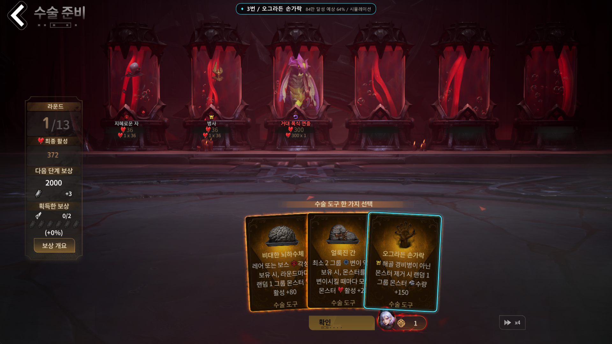
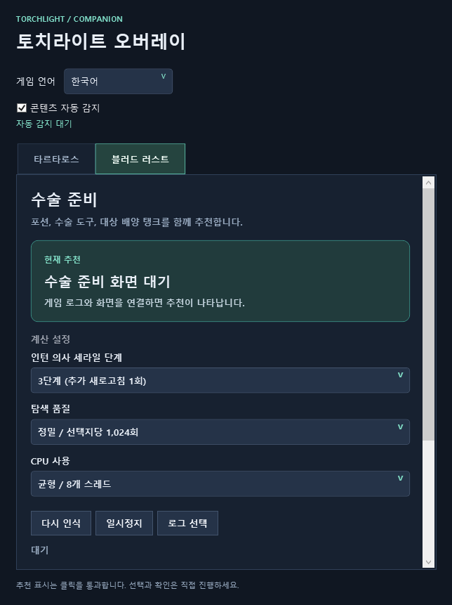

# 토치라이트 오버레이

토치라이트: 인피니트의 **타르타로스**와 **블러드 러스트 수술 준비**를 위한 한국어 추천 오버레이입니다. 화면과 게임 로그를 읽어 카드와 대상 탱크를 표시합니다. 선택은 플레이어가 직접 합니다.

**[최신 Windows ZIP 다운로드](https://github.com/kinam-ssafy/torchlight-overlay/releases/latest)**



## 설치와 실행

1. Releases에서 `TorchlightHelper-KO-1.0.1-win-x64.zip`을 받습니다. GitHub의 `Source code` ZIP은 실행용이 아닙니다.
2. ZIP **전체를** 쓰기 가능한 폴더에 압축 해제합니다.
3. `TorchlightHelper.exe`를 실행합니다. .NET 런타임과 타르타로스 한국어 OCR 모델이 포함되어 있습니다.
4. 기존 TartarusSolver 등 동일 단축키를 사용하는 도구는 종료합니다.
5. 게임을 창 모드 또는 테두리 없는 창 모드로 실행하고 게임 언어를 선택합니다. `콘텐츠 자동 감지`는 기본으로 켜져 있습니다.

Windows 10/11 x64용입니다. 자동 인식을 사용하려면 게임의 계정 관련 설정에서 로그를 활성화하고 재접속하세요. 자동으로 연결되지 않으면 `로그 선택`에서 다음 파일을 지정합니다.

```text
게임 설치 폴더/UE_game/TorchLight/Saved/Logs/UE_game.log
```

## 콘텐츠 자동 감지

게임 로그를 켜두면 타르타로스 보드와 블러드 러스트 수술 준비에 들어갈 때 자동으로 전환됩니다. **프로그램으로 돌아와 탭을 바꿀 필요가 없습니다.** 선택한 콘텐츠의 엔진만 실행하며, 콘텐츠 종료나 게임 창 종료를 감지하면 대기합니다. 이미 진행 중일 때 프로그램을 실행해도 로그에서 현재 화면을 복원합니다.

자동 모드에서 탭은 설정을 보는 용도입니다. 직접 엔진을 선택하려면 `콘텐츠 자동 감지`를 끄고 탭을 선택하세요. 감지가 계속 대기하면 게임의 로그 활성화 및 로그 파일 연결을 확인하세요. 로그가 없거나 지원하지 않는 형식이면 수동 선택을 사용할 수 있습니다.

## 블러드 러스트



- **펫 단계:** 인턴 의사 세라일의 미보유 또는 1~6단계를 선택합니다. 자동 저장됩니다. 화면에서 읽은 실제 남은 새로고침 횟수를 우선하고, 화면에 없는 초기값만 펫 단계로 보완합니다.
- **탐색 품질:** 256 / 512 / 1,024회. 기본은 정밀 1,024회입니다. 더 많은 미래를 비교할수록 시간이 늘어납니다.
- **CPU 사용:** 게임 우선 / 균형 / 추천 속도 우선. 각각 최대 4 / 8 / 12개 스레드를 사용하며, 실제 CPU 수에 맞춰 제한합니다. 기본은 균형입니다.
- 카드가 펼쳐지면 추천 카드 번호와 밝은 테두리가 나타납니다. 대상이 필요한 포션은 배양 탱크 번호도 표시합니다.
- `다시 인식` 또는 `Ctrl+Alt+X`로 현재 화면을 다시 읽습니다. `Ctrl+Alt+V`로 오버레이를 숨기거나 표시합니다.
- 읽지 못한 카드나 수치가 있으면 추천을 숨깁니다. 가리는 툴팁을 치우고 다시 인식하세요.

금색 카드 제목의 한국어 OCR과 한국어 카드 크기에 맞춘 테두리 정렬을 보완했습니다. Windows 한국어 OCR이 없으면 이미지 인식으로 보완하지만 카드 인식률이 낮아질 수 있습니다.

## 타르타로스

자동 감지 상태에서 타르타로스 보드에 들어가면 연결과 인식이 시작됩니다. 인식 간격과 탐색 품질을 별도로 조절할 수 있습니다. 수동 모드에서는 콘텐츠 탭을 전환하면 이전 엔진이 정지합니다.

| 단축키 | 기능 |
|---|---|
| Ctrl+Shift+S | 지금 인식 |
| Ctrl+Shift+R | 자동 인식 전환 |
| Ctrl+Shift+H | 오버레이 표시 전환 |
| Ctrl+Shift+B | 로컬 진단 저장 |

## 추천이 뜻하는 것

타르타로스는 원본 솔버의 보상 가치와 목표를 사용합니다. 블러드 러스트는 현재 상태에서 미래 카드를 시뮬레이션해 **84만 활성 목표**에 유리한 선택을 비교합니다. 표시되는 비율은 모델의 추정이며 실제 성공이나 수익을 보장하지 않습니다.

- 수술 플랜 **11~13라운드**는 캐릭터 생존력과 전투 조건에 따라 직접 선택하도록 안내합니다.
- 한국어 카드명 78개를 연결했습니다. 미확인 7개 명칭은 영어로 표시됩니다.
- 일부 특수 포션의 연속 효과와 모든 해상도/UI 배율/HDR 환경은 검증되지 않았습니다.
- 실제 한국어 1920x1080 수술 준비 화면과 원본 회귀 자료로 검증했습니다. 전체 완주 보장이나 시장 시세 기반 수익 최적화 도구는 아닙니다.

성능 수치와 실패 후 수정 내역은 [검증 기록](VALIDATION.md), 게임 자료와 구현 근거는 [조사 기록](RESEARCH.md)에 있습니다.

같은 실제 보드의 균형 모드에서 첫 처리는 약 418~493ms, 동일 화면 재처리는 약 50~59ms로 측정했습니다. 탐색은 1,024회를 유지했습니다. 캡처와 게임 애니메이션 대기는 제외한 수치이며 PC와 보드에 따라 달라집니다.

## 설정과 데이터

설정과 로컬 기록은 실행 파일 옆 `user-data`에 저장됩니다. 업데이트 ZIP은 새 폴더에 풀고 필요할 때 기존 `user-data`만 옮기세요. 다른 사람에게 공유할 때는 Releases의 ZIP을 사용하세요. 본인 사용 폴더에는 설정, 게임 로그 경로, 진단 화면이 들어갈 수 있습니다.

게임 메모리를 읽거나 변경하지 않고, 게임에 클릭이나 키 입력을 보내지 않습니다. 화면과 로그를 로컬에서 처리하며 자동 업데이트와 오류 자동 전송은 비활성화했습니다.

## 빌드와 출처

- `tartarus/`: [glcoder/TartarusSolver](https://github.com/glcoder/TartarusSolver) v0.7.20, MIT.
- `vorax/`: [DinoRaos/vorax-solver-rs](https://github.com/DinoRaos/vorax-solver-rs) `9aabc20`, MIT. 원본 엔진은 tidewarden의 마지막 MIT 커밋 `7b4c9ba`까지입니다.
- 게임 용어 대조: [TLIDB](https://tlidb.com/ko/Vorax_Season).

Windows에서 .NET SDK 9 이상, Rust GNU 툴체인, Python 3을 설치합니다. 배포 ZIP의 `models/ocr`를 `tartarus/models/ocr`로 복사한 다음 실행합니다.

```powershell
./build.ps1
python package.py
```

검증 명령:

```powershell
cargo test --release --workspace --manifest-path vorax/Cargo.toml
dotnet test tartarus/tests/Tartarus.Rules.Tests/Tartarus.Rules.Tests.csproj -c Release -p:Platform=x64
```

[라이선스와 종속성 고지](THIRD_PARTY_NOTICES.md)를 유지해 주세요. 게임명과 게임 자산은 권리자에게 귀속됩니다. 이 프로젝트는 비공식 팬 도구이며 게임 제작사의 공식 제품이 아닙니다.
